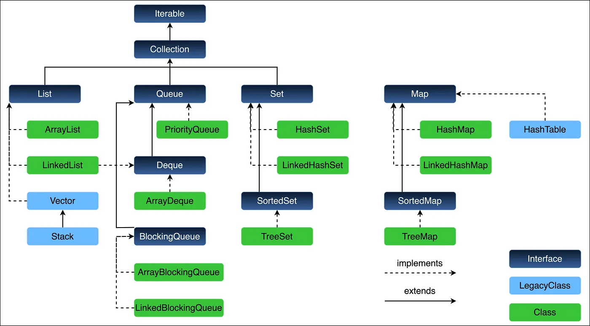

# What is collection framework?

The Java Collection Framework is set of classes ad interfaces provided by java to store, manage, and manipulate groups of objects efficiently.

Before collections, developers used arrays, which have limitations:

- Fixed Size
- Difficult insertion/deletion
- No built-in searching or sorting

Collections solve these problems by providing dynamic data structure.

## Hierarchy Diagram

## Collections
A utility class that provides static methods for sorting, searching, and modifying collections.

## 1. List interface
- Maintain insertion order
- allow duplicates
- indexed access
## 2. Set Interface
- No Duplicate Elements
- Store Unique Values
## 3. Queue Interface
Queue is interface in java used when we need to process elements in specific order. The default behaviour is FIFO. Common implementations are LinkedList, ArrayDeque, PriorityQueue and BlockingQueue. we use queues for task processing BFS, producer-consumer systems and priority based processing.
## 4. Map interface
Store data as key-value pairs.

# What is the difference between HashMap and ConcurrentHashMap?

The main difference is thread safety. HashMap is not thread-safe, whereas ConcurrentHashMap is designed to handle concurrent access by multiple threads.

For example, if multiple threads are updating a shared HashMap without proper synchronization, we can face race conditions and lost updates.

ConcurrentHashMap handles concurrent operations internally using mechanisms like CAS and synchronization at the bucket level, so it allows multiple threads to access and update the map safely.

Another difference is that HashMap allows one null key and multiple null values, whereas ConcurrentHashMap doesn't allow null keys or values.

# How HashMap work internally?

HashMap internally uses array of buckets. when key-value pair is inserted, HashMap calculates the key's hashcode, determines the bucket index, and store the entry there. if multiple keys maps to the same bucket, collisions are handled using linked list and, from java 8 onwards, a red-black tree when bucket becomes large. During retrieval, HashMap uses hashCode() to locate the buckets and equals() to identify the exact key. Average time complexity for put() and get() is O(1), while worst case is O(log n).

# What happens if two keys have the same hashcode?

If two different keys have the same hashcode, they may end up in the same bucket, which is called a hash collision. HashMap handles this using a linked list or, when the bucket becomes sufficiently large and the table capacity allows it, a red-black tree. It uses equals() to distinguish between the keys and store their values separately.

# What is the difference between hashCode() and equals()

hashCode() helps HashMap identify the bucket where a key should be stored, whereas equals() checks whether two keys are logically equal.

If two objects are equal according to equals(), they must have the same hashcode. However, two objects can have the same hashcode and still not be equal.

That's why HashMap uses both methods.

# What happens if I override equals() but not hashCode()?

This can cause problems when using custom objects as HashMap keys. Two objects might be logically equal but have different hashcodes, so HashMap may place them in different buckets and fail to find an existing mapping as expected.

Therefore, whenever I override equals(), I should also override hashCode() to maintain the contract.

# What is the default capacity and load factor of HashMap?

By default, HashMap has an initial capacity of 16 and a load factor of 0.75. This means the resize threshold for a table of capacity 16 is 12 entries. When the number of entries exceeds that threshold, HashMap increases the table capacity, typically doubling it, and redistributes the entries.

# When does a linked list convert into a red-black tree?

In Java 8 and later, when a bucket reaches the treeification threshold of 8 entries, HashMap may convert the linked list into a red-black tree. However, the table capacity must be at least 64. If the capacity is smaller, HashMap prefers resizing the table instead.

# What is the time complexity of HashMap?

Under normal conditions with a good hash distribution, put() and get() take O(1) average time. When collisions occur, operations in a linked-list bucket can take O(n). After treeification, operations are generally O(log n) within that bucket, assuming the tree remains balanced and comparisons support efficient navigation.

# What happens internally when HashMap resizes?

When the number of entries exceeds the threshold, HashMap increases the capacity of its internal array, typically doubling it. It then redistributes the existing nodes into the new table based on their hashes.

In Java 8, this redistribution is optimized because a node generally either stays at its existing index or moves to the index obtained by adding the old capacity. This avoids recalculating the key's hashCode() for every entry.

# Can we use a mutable object as a HashMap key?

Yes, technically we can, but it is risky if the fields used by equals() and hashCode() change after insertion. The object may no longer be found in the bucket where it was originally stored.

That's why I prefer immutable objects as HashMap keys, such as String or immutable custom classes.

# Is HashMap thread-safe?

No, HashMap is not thread-safe. If multiple threads modify it concurrently without proper coordination, we can encounter race conditions and lost updates. If I need a shared map for concurrent access, I would consider ConcurrentHashMap or appropriate external synchronization, depending on the use case.

# What happens if we use a custom object as a key?

HashMap calls the object's hashCode() to determine the bucket and uses equals() to identify an existing key. For a custom class, I need to implement both methods correctly so logically equal objects behave as expected when used as keys.

# Quick-fire follow-up questions
These are also worth preparing for a senior Java interview.

## 1. Can HashMap store null keys and null values?
Yes. HashMap allows one null key and multiple null values.

## 2. What happens if I insert the same key twice?
The existing value is replaced; the map does not create a second mapping for an equal key.

## 3. Does HashMap maintain insertion order?
No. HashMap does not guarantee insertion order. LinkedHashMap maintains a defined encounter order.

## 4. Why is String commonly used as a HashMap key?
String is immutable and has consistent equals() and hashCode() behavior, making it a reliable key.

## 5.What is the difference between HashMap and Hashtable?
HashMap is not synchronized and permits null keys and values. Hashtable is synchronized and does not permit null keys or values. ConcurrentHashMap is generally preferred for modern concurrent use cases.
## 6. Can two different keys have the same hashcode?
Yes. Hashcodes are integers, so collisions are possible. HashMap uses equals() to distinguish unequal keys.

# What is the formula used to calculate the bucket index in HashMap?

HashMap uses two steps to calculate the bucket index.

First, it calculates the hash using the key's hashCode() method and spreads the higher bits into the lower bits using the XOR operation.

The formula is h ^ (h >>> 16).

Second, it calculates the bucket index using (n - 1) & hash, where n is the length of the internal array.

HashMap uses bitwise AND instead of the modulo operator because the array capacity is always a power of two, making the calculation efficient.

For example, if the array capacity is 16, the bucket index is calculated using (16 - 1) & hash, which is 15 & hash.

This is how HashMap efficiently determines which bucket should store the key-value pair.

# What is the difference between fail-fast and fail-safe iterators?
# What is ConcurrentModificationException?
# Comparable vs Comparator
# ArrayList vs LinkedList
# HashMap vs TreeMap
# HashSet vs TreeSet

# How does HashSet work internally?

HashSet internally uses a HashMap. When I add an element to a HashSet, the element becomes the key in the internal map, and a shared dummy object is used as the value.

HashSet uses hashCode() and equals() to identify duplicates. If an equal element already exists, it doesn't add another element.
